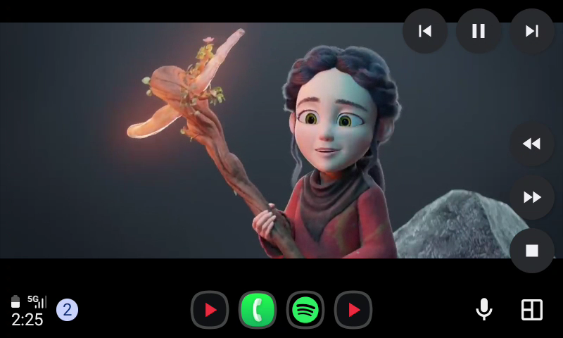
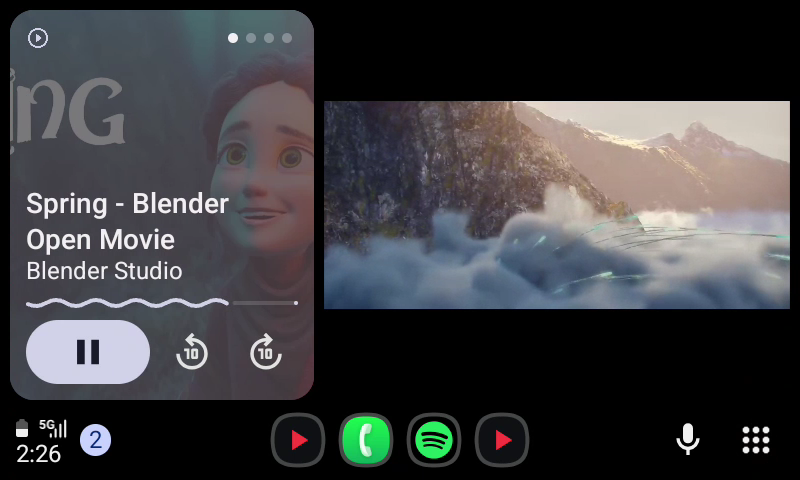
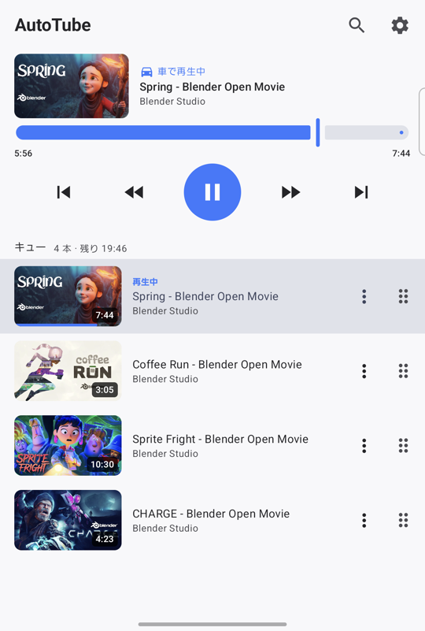
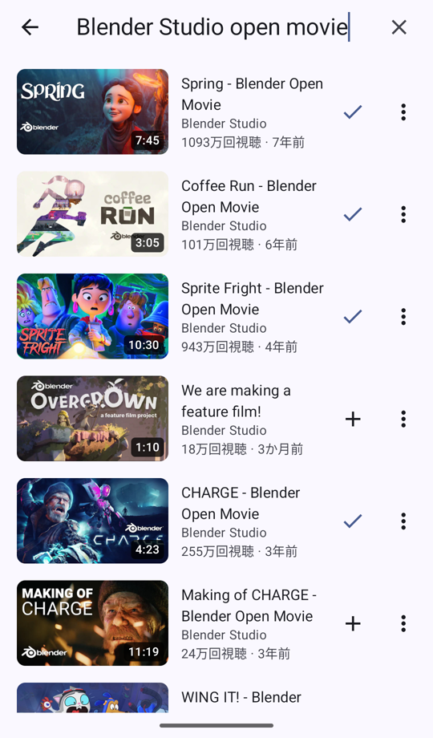
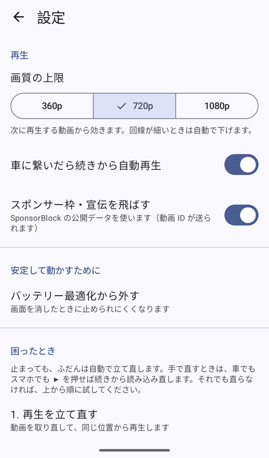

# AutoTube

Android Auto の車載画面で YouTube を再生するアプリ。スマホでキューに積み、車側は再生するだけ。

[English README](README.md)（こちらが正本です。日本語版は補足で、内容が古いことがあります）

## スクリーンショット

**車（Android Auto）**: 全画面と、分割表示（左がメディアカード、右に映像）

<p>
  
  
</p>

**スマホ**: キュー（車で再生中）・アプリ内検索・設定

<p>
  
  
  
</p>

<sub>画面に映っている動画は Blender Studio のオープンムービー（Spring・Coffee Run・Sprite Fright・CHARGE、© Blender Foundation, [CC BY](https://creativecommons.org/licenses/by/4.0/)）です。車の画面は Android Auto Desktop Head Unit、スマホは Galaxy Z Fold とエミュレータで撮影。</sub>

## ⚠️ 先に読んでください

- **走行中も映像は止まりません。** このアプリは Android Auto に「ナビアプリ」として振る舞うので、Android Auto の走行中制限が効きません。運転中に画面を見ることは危険で、多くの国・地域で法令違反です。**運転者は走行中に見ないでください。** 使い方はすべて自己責任です
- **Google・YouTube とは無関係の非公式アプリです。** YouTube の公式 API ではなく、[NewPipeExtractor](https://github.com/TeamNewPipe/NewPipeExtractor) でストリームを取り出して直接再生します。YouTube の利用規約上はグレーで、YouTube 側の変更でいつでも動かなくなる可能性があります
- **Google Play では一般公開していません（できません）。** 理由と入れ方は「[インストール](#インストール)」を見てください

## できること

- **アプリ内で YouTube を検索してキューに追加**（入力中の候補つき）。YouTube アプリの「共有」から、URL のコピーから、再生リストの URL（最大 200 本）からも追加できる
- **車で開くと前回の続き（動画と位置）から自動で再生**。ステアリングの再生・次・前のキー、スマホの通知・ロック画面からも操作できる
- **広告が出ない**（動画ファイルを直接再生するため）。動画に埋め込まれたスポンサー枠・宣伝は [SponsorBlock](https://sponsor.ajay.app) で自動で飛ばす（設定で切れる）
- **止まりにくい**: YouTube の帯域制限を避ける取り方、最大 5 分の先読み、圏外・トンネルからの自動復帰、回線が替わったとき（家の Wi-Fi → 5G）の URL の差し替え、失敗したときの自動やり直し
- スマホ側は Material 3。スワイプで削除・視聴済み、ドラッグで並べ替え、取り消し可能

## インストール

### なぜ Play ストアから入れないといけないのか（サイドロードの制約）

実車の Android Auto は、Car App Library 製のアプリ（このアプリのようなナビ・駐車・充電などのカテゴリ）を、**インストール元が Google Play ストアのものだけ**ランチャーに出します。端末に記録された「インストール元パッケージ」が `com.android.vending` かどうかで判定しています。

- APK を直接入れる、F-Droid・Galaxy Store などほかのストアから入れる → **どれも実車には出ません**（DHU には出る）
- Android Auto の開発者設定「提供元不明のアプリ」は、メディア・メッセージ系のアプリにしか効きません。このアプリには関係ありません
- かといって Google Play での一般公開は、YouTube の規約・広告を出さないこと・ナビを名乗って動画を出すことから、審査をまず通りません

### 方法 1: adb でインストール元を指定して入れる（おすすめ）

PC から adb で入れるときにインストール元を `com.android.vending` と指定すると、Play から入れたのと同じ扱いになり、実車に出ます。

```bash
adb install -r -i com.android.vending AutoTube.apk
```

- スマホの「開発者向けオプション」で USB デバッグ（またはワイヤレスデバッグ）をオンにしておく
- **更新のたびにこの方法で入れ直す**必要があります（スマホ上で APK を開いて上書きすると、インストール元が変わって車に出なくなる）
- 入れ直したら車との接続をやり直す（Android Auto はアプリ一覧を接続開始時にしか作り直さない）

APK は [Releases](https://github.com/zntrimi/autotube/releases) から取るか、下の「[ビルド](#ビルド)」で作ります。

### 方法 2: 自分の Play Console の内部テストに上げる

Google Play Console の開発者アカウント（登録料 25 ドル）があれば、内部テストトラックに上げて自分だけに配れます。審査なしで Play から入るので、更新もスマホだけで済みます。

1. `app/build.gradle.kts` の `applicationId` を自分のものに変える（`com.autotube.zentaro` は作者のアプリ枠なので使えない）
2. Play Console でアプリを作成し、内部テストのテスターに自分の Google アカウントを登録して、オプトインリンクを一度開く
3. `scripts/release.sh` で AAB を作って上げる（`--upload` を使うなら下の「[リリース](#リリース作者向け)」を参照）

## 使い方

### 追加

- 右上の 🔍 で検索して ＋。⋮ から「今すぐ再生」「次に再生」
- YouTube アプリで動画を開き「共有」→ AutoTube
- URL をコピーしてから AutoTube を開くと、キューの上に追加カードが出る。検索欄に URL を貼っても追加できる
- **再生リストの URL**（`youtube.com/playlist?list=…`）を貼るとまとめて追加（最大 200 本、重複は飛ばす）

### 車で

- 車に繋いで AutoTube を開くと、**前回の続き（動画と位置）から自動で再生**（設定で切れる）
- 右上: 前・再生/一時停止・次。右下: −10 秒・+30 秒・停止
- ステアリングの再生・次・前のキーも効く
- 見終わった動画は視聴済みになり、自動送りでは飛ばす。次の動画が無ければ止まる
- 左上のカードは動画が替わって 5 秒だけタイトルを出し、あとは消える（一時停止・読み込み中・エラー・キューが空のときは出しっぱなし）
- Android Auto はナビ画面のボタンを数秒で隠す。隠れているときの 1 回目のタップは再表示だけ

### スマホで

- **キュー**: 上に再生中のパネル（車に繋いでいる間はサムネイルと「車で再生中」）。タップで再生、右へスワイプで視聴済み、左へスワイプで削除（どちらも取り消せる）、右端のつまみで並べ替え、⋮ で次に再生・先頭へ・YouTube で開く
- **検索**: 入力中は候補、結果はスクロールで続きを読む。ライブ配信は再生できないので出さない
- **設定**: 画質の上限（360p／720p／1080p）、自動再生、スポンサー枠スキップ、バッテリー最適化、困ったとき（下記）
- スマホ側の画面を閉じても車での再生は続く

### 止まったとき

ふだんは何もしなくても自動で立て直します。

| 状況 | アプリの動き |
|---|---|
| 圏外・トンネル | 「回線待ち」と出し、戻ったら続きから |
| URL の失効・回線の切り替わり | 裏で取り直して止まらずに続く |
| 削除・非公開などで再生できない動画 | 飛ばして次へ。一覧に「再生できません」と出る |
| それ以外の失敗 | 「再生できませんでした」と出し、10 → 20 → 40 → 60 秒の間隔で自動でやり直す |

手で直すときは **▶ を押す**（車でもスマホでも、取り直して同じ位置から再生する）。それでも駄目なら設定の「困ったとき」を上から順に: 再生を立て直す → 再生をすべてリセット → アプリを再起動。直らなければ「ログを見る・共有する」からログを取れます。

## 仕組み

**ナビカテゴリを名乗って `NavigationTemplate` の Surface をもらい**、そこに ExoPlayer で描画します。Canvas 描画と MediaCodec は同じ Surface に同居できないので、車側の Surface はまるごとプレイヤーに渡し、タイトルや状態は NavigationInfo のカードで出しています。

| 役割 | 実装 |
|---|---|
| ストリーム URL の取得 | [NewPipeExtractor](https://github.com/TeamNewPipe/NewPipeExtractor)（`youtube/YouTubeExtractor.kt`）。映像のみ MP4（設定の上限、既定 720p。AV1 は使わず、同じ高さなら 30fps を優先）＋ M4A 音声を `MergingMediaSource` で合成。失敗したら形式を問わない合成 → 音声込み 360p プログレッシブの順にフォールバック。結果は 45 分キャッシュし、再生中に次の動画の分を先読みする |
| 再生 | media3 ExoPlayer（`player/PlayerEngine.kt`）。車の Surface が最優先、無ければスマホの PlayerView |
| MediaSession | `player/PlaybackService.kt`（media3 `MediaSessionService`）。「次」「前」は `QueuePlayer` でこちらのキューに向ける。再生中はフォアグラウンドサービス |
| 帯域制限よけ | YouTube は 10MB を超える範囲の要求を最初の 8〜10MB だけ速く送り、あとは約 3.3Mbps に絞る。ExoPlayer は末尾なしの範囲で読み続けるので、`player/ChunkedDataSource.kt` で 4MB ずつの範囲指定に分けて取る（区切れば毎回全速）。バッファは最大 5 分先（96MB まで） |
| 回線落ち対策 | 回線のエラー（切断・タイムアウト・5xx）は読み込みの中で何回でもやり直し、プレイヤーまで上げない（上げると先読みした分を捨てて止まる）。ストリーム URL は取得時の IP でしか使えないので、403 を受けたら `ChunkedDataSource` が裏で同じ itag の新しい URL に差し替える。圏外の間は画質を落とさない |
| 詰まり・失敗 | 映像の縮小・配置（エフェクト）が失敗したら準備し直し、2 回失敗したら以後は上下を切った全面表示。バッファが 20 秒進まなければ候補を一段落とす（最大 3 回）。打つ手が尽きたら間隔を延ばしながら自動でやり直す |
| オーディオフォーカス | 再生開始時に取得して他のアプリを止めるが、**奪われても止まらない**（YouTube アプリで次の動画を開いて共有するたびに車側が止まるのを避けるため） |
| 縦横比・配置 | Surface に収まる最大サイズ（`Presentation` エフェクト）。分割表示ではホストの可視領域に合わせて右カードの中に収める（`CarLayoutTransformation`） |
| キュー | `queue/QueueStore.kt`。`filesDir/queue.json` に保存。再生位置・視聴済み・再生できない印も持つ |
| スマホの画面 | Jetpack Compose + Material 3（`phone/ui/`）。並べ替えは [Reorderable](https://github.com/Calvin-LL/Reorderable) |
| スポンサー枠 | `youtube/SponsorBlock.kt`。設定でオンのとき、再生する動画の ID が SponsorBlock のサーバーへ送られる |

## ビルド

JDK 21 と Android SDK が要ります。

```bash
export JAVA_HOME=/path/to/jdk-21        # macOS + Homebrew なら /opt/homebrew/opt/openjdk@21/libexec/openjdk.jdk/Contents/Home
echo "sdk.dir=/path/to/android-sdk" > local.properties
./gradlew :app:assembleDebug
adb install -r -i com.android.vending app/build/outputs/apk/debug/app-debug.apk
```

- debug 版はパッケージ名 `com.autotube.zentaro.debug`・表示名「AutoTube 開発版」で、release 版と並んで入る（キューも別）
- 署名: `~/.android/personal-release.properties`（`storeFile` / `storePassword` / `keyAlias` / `keyPassword`）があればその鍵で debug・release とも署名し、無ければ Android の debug 鍵で署名する。鍵はリポジトリに入れない
- 実車の Android Auto はデバッグ可能なアプリを候補から外すので、**実車で使うのは release 版**（`./gradlew :app:assembleRelease`）。DHU なら debug 版でも出る
- NewPipeExtractor は、YouTube の変更に追従した未リリースの修正版を `localMaven/` に同梱している（作り方とソースは `localMaven/README.md`）。上流で新しい版が出たら `gradle/libs.versions.toml` を戻す

### 車なしでテストする（DHU）

Android SDK の「Android Auto Desktop Head Unit Emulator」（`extras;google;auto`）を使います。

1. スマホの Android Auto の設定で「バージョン」を 10 回タップして開発者設定を有効にし、右上 ⋮ →「Start head unit server」を押す（DHU が切れるたびに押し直す）
2. スマホを adb で繋いで（USB でもワイヤレスデバッグでもよい）:

```bash
adb forward tcp:5277 tcp:5277
$ANDROID_SDK/extras/google/auto/desktop-head-unit
```

DHU の標準入力に `screenshot out.png`・`tap 400 240`・`keycode media_next` などを送ると操作できる（`help` で一覧）。接続中にアプリを `adb install` で入れ直すと接続が切れるので、入れ直したらサーバーを起動し直す。

### リリース

GitHub の Releases に APK を置くときは `scripts/github-release.sh <version>`（release 版をビルドして `gh release create`）。

Play の内部テスト（作者向け）: `scripts/release.sh` は AAB を作ってデスクトップに置く。`--upload` を付けると Play の内部テストトラックに上げ、繋がっているスマホの Play ストアで更新まで進める（`scripts/play-track.sh`）。アップロードには、Play Console に招待したサービスアカウントと、それになりすませる gcloud アカウントを環境変数で渡す:

```bash
export PLAY_SERVICE_ACCOUNT=play-uploader@<project>.iam.gserviceaccount.com
export PLAY_GCLOUD_ACCOUNT=<なりすまし権限を持つ gcloud アカウント>
scripts/release.sh --upload
```

## 参加する

不具合の報告・翻訳・プルリクエストを歓迎します。先に [CONTRIBUTING.md](CONTRIBUTING.md) を読んでください。

## ライセンス

[GPL-3.0](LICENSE)。GPL-3.0 の [NewPipeExtractor](https://github.com/TeamNewPipe/NewPipeExtractor) を組み込んでいるため、このアプリも同じライセンスです。

YouTube は Google LLC の商標です。このプロジェクトは Google・YouTube とは関係ありません。
